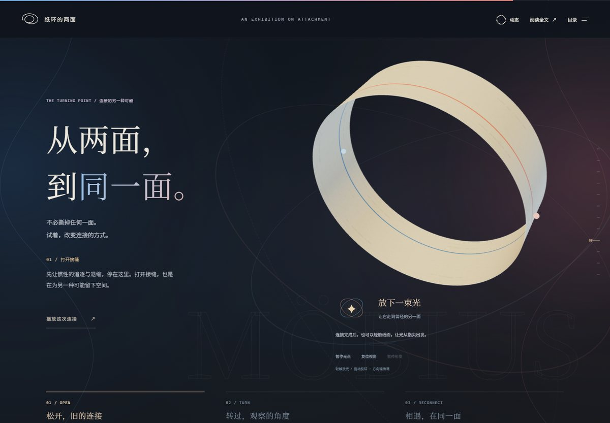

# 纸环的两面

> 一场关于亲密关系的十二幕交互展览。
> 原文《纸环的两面——论回避型恋人和焦虑型恋人在异地恋中如何相处》，作者 **Cannin·Cheung**（河北 中国）。

**在线观看**：<https://iceyt520.github.io/paper-ring/>　｜　**仓库**：<https://github.com/IceyT520/paper-ring>　｜　**单文件**：[纸环的两面.html](纸环的两面.html)（离线可用）　｜　**原文**：[纸环的两面.pdf](纸环的两面.pdf)

[](https://github.com/IceyT520/paper-ring/actions/workflows/pages.yml)
[](https://github.com/IceyT520/paper-ring/actions/workflows/release.yml)
[](LICENSE)

[](纸环的两面.html)

| 同一张纸，两个世界 | 内侧：折页合拢，遮住"想靠近" | 沙盘：临界距离是一条平衡线 | 扭转之后，光走到另一面 |
| --- | --- | --- | --- |
|  |  |  |  |

---

## 这是什么

- **12 章**：扉页 / 未回复 / 纸环 / 内侧 / 外侧 / 镜像 / 异地 / 沙盘 / 解结 / 结语 / 致谢 / 原文与参考。
- **全文一段不漏**：71 个原文块、13,176 字全部在页面里；另有一个「阅读全文」模式按 PDF 原顺序排列，两种模式共用同一份经过校订的正文。
- **一条真实的三维纸带**：开场侧光勾出纸环，红蓝细线从两端展开；纸带上的两个光点各自行走（红在前、蓝在后），第 09 章可以把它扭转、接合成莫比乌斯环，让一束光沿着纸面走到"曾经的另一面"。
- **六个可动手的装置**：投信纸（短拉会回弹）、叩纸回声、红蓝空间相遇、恐惧滤镜、追问计数、缝线四约定。
- **两个原句，一个动作**：第 06 章始终保留蓝色“不能失去自己”和红色“不能没有你”。轻触图形，两个完整圆面靠近，交叠处成为“我们”，两侧仍保有“我”和“你”；再次轻触即可重看。
- **一个可调的沙盘**：原文的耦合方程 `dA/dt=αR/D−βA`、`dR/dt=γA−δR`，解析解 + 相平面；临界距离 `D*=αγ/(βδ)` 处画出的是平衡线，不是单点。
- **开场是一封可以拆的信**：蜡封、折页、信纸；拆开的同时音乐开始。第 09 章的那次"连接"是一个门槛——没播完，页面不让你继续往下。
## 直接观看

双击 [纸环的两面.html](纸环的两面.html)。字体、样式、脚本、三维组件、**背景音乐全部内嵌在这一个文件里**，不联网、不带附件也能看能听。把它和 [纸环的两面.pdf](纸环的两面.pdf) 放在同一目录，"打开原始 PDF / 下载原文"两个入口才可用（正文本身已内嵌，不依赖 PDF）。

## 怎么分享给别人

- **发文件**：把 `纸环的两面.html` 直接发过去就行——音乐已经内嵌（单文件约 16 MB），对方双击、拆信就有声，不需要任何附件。
- **发链接**：<https://iceyt520.github.io/paper-ring/>。链接是完整站点，音频单独流式加载，首屏更快。
- Release 里的 `paper-ring-vX.Y.Z-share.zip` 仍然可用：里面是自包含的 HTML 与 PDF，发给不熟悉技术的人更省事。

## 开场信封与背景音乐

进入展览前先看到一封封着的信：轻触拆开，蜡封裂开、信纸抽出，音乐从这一刻开始，然后接上开场动画。

- **曲目**：G.E.M. 邓紫棋《唯一》（10.2 MB，4:13）。源码里是 `website/public/theme.mp3`；单文件版以 base64 内嵌，运行时转成 blob 播放。
- **播放**：与拆信同一个手势开始，2.4 秒淡入到 30%，单曲循环；右上角 ♪ 可随时关闭，选择记在 `localStorage`（`paper-sound`）。
- **流量**：线上版只预读音频头（`preload=metadata`），真正下载发生在拆信那一刻；单文件版因为内嵌，打开即载入全部音频。
- **跳过信封**：带 `#` 的深链、浏览器前进/后退，或地址加 `?nogate=1`，直接进入展览（此时音乐等第一次点击再开始）。
- **换歌**：替换 `website/public/theme.mp3` 后 `pnpm release`；若删掉该文件，单文件版与线上版都会静音并隐藏 ♪。

**版权提醒**：《唯一》的词曲与录音版权归权利人所有，不在本仓库的 MIT 授权范围内；它是应作者要求随作品展示的。若权利人提出要求，会移除该文件。

## 目录

```
纸环的两面.html          发布成品：单文件交互展览（约 16 MB，含内嵌音频）
纸环的两面.pdf           原文（10 页 / 13,176 字）
website/                源码工程：Vite + TypeScript + Three.js + GSAP
  content/article.json     71 个原文块，含章节、页码、原文偏移
  content/corrections.json 37 条逐项校订（原句、改法、理由）
  scripts/                 静态渲染、单文件打包、11 个浏览器验收脚本
  src/                     版式、交互、三维纸带、数学模型、开场编排
纸环的两面_作品大纲.md     14 节内容大纲（覆盖核对表在第十三节）
纸环的两面_内容摘要.md     原文摘要
纸环的两面_交互原型.html   早期模拟器原型（已被第 08 章取代，留作过程记录）
AI交接说明.md             实现约束、踩过的坑与审美偏好（写给下一位接手的人）
docs/preview/              README 用的预览图
.github/workflows/        Pages 部署 + 标签发布
```

## 开发

需要 Node.js 22.12+ 与 pnpm：

```sh
cd website
pnpm install
pnpm dev            # 本地开发（http://127.0.0.1:4173）
pnpm test           # 12 个单元测试
pnpm check:content  # 逐字核对原文 / 校订 / 双模式 / 单文件成品
pnpm release        # 重建页面、打包单文件、校验（发布前跑这一条）
pnpm build          # 生产构建到 dist/（可部署静态托管）
```

## 版本与发布

每个版本都走同一条路：**提交 → 标签 → 推送**。推送标签后 GitHub Actions 会自动构建、把单文件 HTML 与 PDF 附到 Release，并把 `main` 部署到 GitHub Pages。

```sh
cd website && pnpm release && pnpm test
cd ..
git add -A
git commit -m "release: v1.2.0"
git tag v1.2.0
git push --follow-tags
```

`website/scripts/paths.mjs` 是发布文件名的唯一来源：成品固定写到根目录 `纸环的两面.html`，打包脚本和 `--offline` 验收脚本都从它取路径。版本记录见 [CHANGELOG.md](CHANGELOG.md)。

## 内容与校订

原文共 10 页、13,176 字，从 PDF 文本层逐字提取，拼接后可完整重建原文本。所有改动集中在 [website/content/corrections.json](website/content/corrections.json)：标点与助词的修正、一处依恋类型的指代误写、以及几处与方程不符的模型说明；每条都保留原句、改法与理由，PDF 原件不被覆盖。

模型部分按保留的方程解释：线性系统在 `D*` 处存在一条非零平衡线；`D<D*` 时变量长期发散（页面明确显示，不裁剪到 [0,1]），`D>D*` 时衰减；这组方程的特征值为实数，不产生周期振荡。"有界扩展"是另加的饱和假设，单独标注。第 11 章那句"我们见一面吧"是情境补白，不是原文，页面第 12 章有说明。

## 授权

- **代码**（`website/` 下的脚本、样式、三维与交互实现）：MIT，见 [LICENSE](LICENSE)。
- **正文与 PDF**：《纸环的两面》文字版权归原作者 **Cannin·Cheung**。它随本仓库和网页一起发布，是为了完整呈现这部作品，**不在 MIT 授权范围内**；转载、商用或再发布正文请联系作者。
- **音乐**：G.E.M. 邓紫棋《唯一》，词曲与录音版权归权利人，**不在 MIT 授权范围内**；随作品展示，若权利人要求会移除。
- **字体**：Noto Serif SC / Noto Sans SC（思源字族），SIL OFL 1.1，见 [website/public/fonts/OFL.txt](website/public/fonts/OFL.txt)。
- **三维与动画**：Three.js、GSAP，许可证随依赖分发。

## 第六章更新（v1.11.0）

“不能失去自己”和“不能没有你”是这幅图的核心，始终分别放在左右两边，任何状态都不消失或改写。互动简化为一次点击：蓝红两个半透明圆面缓缓靠近，真实交叠的区域亮起“我们”；两个圆的大小不变，两侧保留清楚的个人空间。再次点击重看，无拖条、无多步操作。

本轮通过 12 个单元测试、19 项浏览器综合检查、单文件离线检查，以及 1440 / 768 / 390 / 360 四种宽度下的键盘和触屏检查。新增两句原文始终存在的验收，覆盖动画中、完成后和重播；几何检查覆盖圆面不缩小、共同区域与实际交点一致。`scripts/profile-mirror.mjs` 可复测帧间隔、长任务和静止后的 DOM 更新。

## 此前已验证（v1.7.0）

- 71 个原文块在展览、全文、单文件成品三处逐字一致；37 条校订同时应用；引号成对。
- 10 个单元测试：解析解与 RK4 互证（1e-9）、临界平衡线上每点不动、临界处有界系统的边缘收敛、纸带与光点始终贴合表面、莫比乌斯接缝连续、触控可从任一面出发。
- 浏览器验收：信封真的被点开（入场、开场启动、音乐播放）、♪ 开关与记忆、四种宽度无溢出、无 console 错误；信纸短拉回弹且不会被当成点击；光点持续行走；防御光影随折页开合与翻面改变；07.6 的遮挡是淡出而非硬切；莫比乌斯未连接时滚轮下翻被拒、连接后放行。CI 每次部署都会对打包后的单文件跑 `qa-offline` 与 `qa-alignment --offline`。
- 单文件脱离附件实测：把 HTML 单独放进空文件夹打开，拆信后 `#theme-audio` 从 blob 播放，时长 253.7s、`loop=true`、音量 0.30、`currentTime` 正常推进。
